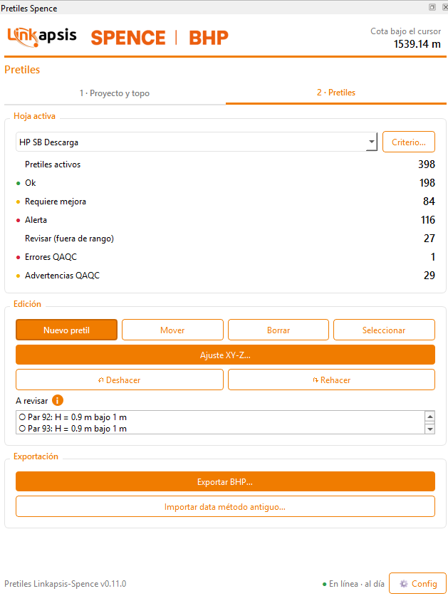
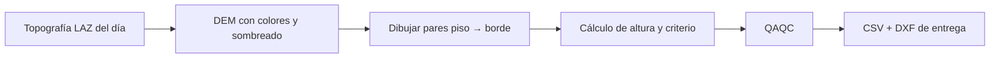
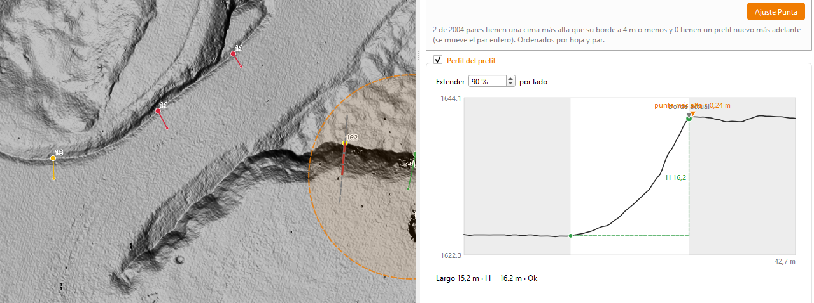
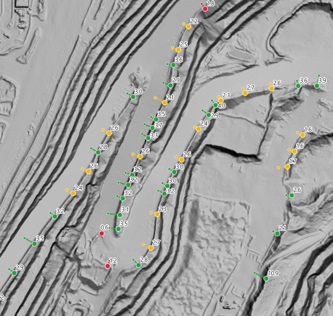

# PLUGIN-ALTURA-PRETILES-SPENCE

Plugin de QGIS para medir la altura de pretiles sobre la topografía del día y generar los archivos de entrega (CSV y DXF).

> 🔒 Código privado. Este repositorio solo describe el proyecto; no incluye código ni datos de la operación.
>
> 🚧 En desarrollo activo (v0.11).

  

## El problema

La altura de cada pretil se medía con un flujo manual:

1. En Global Mapper se dibujaba una polilínea en zigzag piso–borde sobre la topografía LAZ del día.
2. Los vértices se exportaban a CSV y se pegaban en una de 7 hojas de Excel.
3. Con macros se armaban el CSV y el DXF de entrega.

Eso tenía fallas concretas: si un vértice quedaba fuera de orden, todos los pares siguientes se corrían sin aviso; el mismo copiar y pegar se repetía 7 veces, y a veces se entregaban alturas menores o iguales a cero.

## La solución

Todo el flujo pasa a QGIS:

- Cargar la topografía del día (LAZ a DEM) con colores y sombreado.
- Dibujar cada pretil como un par piso → borde, viendo la altura **antes** de confirmar el clic.
- Revisión automática (QAQC) que no deja guardar alturas ≤ 0 ni pares rotos.
- Exportar el CSV y el DXF con el mismo formato que se entregaba antes.
- Unir el trabajo de varios operadores en un solo entregable.

## Ejemplos

**Ajuste automático de la punta del pretil.** El plugin lee el perfil del terreno entre piso y borde, y mueve el borde al punto más alto para que la altura quede bien medida.

**Pretiles ya ajustados en una curva de la mina.** Cada par piso → borde se colorea según su criterio (ok, requiere mejora, alerta) y muestra su altura.

## Cómo se validó

El cálculo vive en Python puro, separado de QGIS, y se prueba con pytest contra datos reales:

| Prueba | Resultado |
|---|---|
| Pretiles del libro Excel original con la misma altura, criterio y observación | 1839 / 1839 |
| CSV de entrega reescrito por el plugin | Idéntico byte a byte |
| DXF de entrega reescrito por el plugin | Mismas entidades, coordenadas y textos |
| Importación desde el CSV de Global Mapper | Mismos 19 pares que la hoja de referencia |

## Tecnologías

Python · QGIS 4 (PyQGIS, Qt6) · PDAL · GeoPackage · pytest

## Estado

Funciona dentro de QGIS con carga de topografía, edición de pretiles con altura en vivo, ajuste automático de la punta, perfil del pretil, QAQC y exportación. Se sigue afinando antes de reemplazar por completo el proceso anterior.

## English

QGIS plugin to measure berm (safety bund) heights on the daily topography and produce the CSV/DXF deliverables, replacing a manual Global Mapper + Excel workflow. The calculation core is pure Python, tested against real data (1839/1839 berms match the original spreadsheet; deliverables reproduced byte for byte). Includes live height while editing, automatic crest adjustment from the terrain profile, QAQC and export. In active development; source code is private.

---
Tito Ruiz Haros · [github.com/titoruizh](https://github.com/titoruizh)
